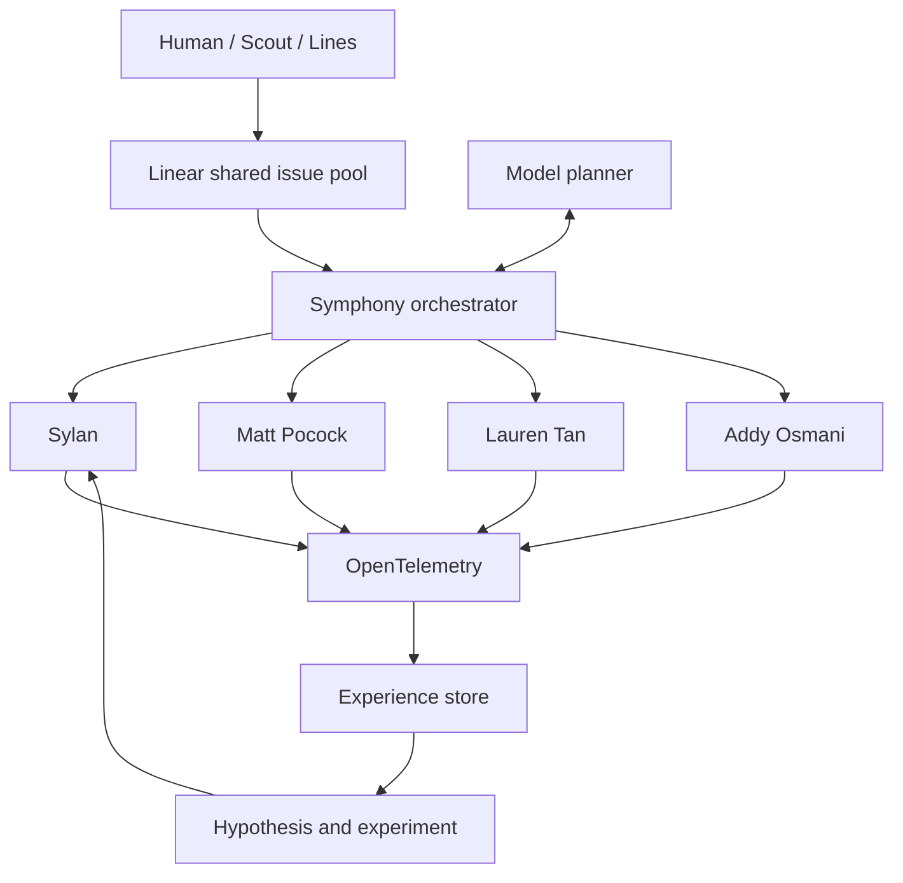

# AI Software Factory

Status: accepted design; runtime capabilities pending audit. See [decisions](DECISIONS.md) and [roadmap](ROADMAP.md).

## Boundaries

- Linear: canonical issue identity, deduplication and exclusive claim. Implement atomic claim or serialized coordinator; do not assume Linear provides locking.
- Symphony: reconcile task state, launch/resume sessions, handle CI/review events and release execution slots while waiting. Original line owns PR through merge/close.
- Profiles: separate global instructions, skills, configuration and memory. Per-task worktree and session. Logical isolation is not a security sandbox.
- Native lines: use upstream installation and routing mechanisms, autonomous skills, native delegation and verification. Respect upstream contribution rules. Periodically sync upstream; record exact revision per task and retain running versions.
- Model planner: intended Astra Ultra controller selects initial model, reasoning and budget, replans on request. Confirm actual supported models/interfaces; no silent substitution. Engineering decisions remain with lines.
- HITL: dynamic complexity/risk-based intervention, centralized inbox linking to native sessions; persist decision and resume. Independent work may continue.
- OpenTelemetry: traces, metrics and logs from first slice; correlate task, session, agent, skill revision, tool, model usage and artifacts. Filter secrets and sensitive data; distinguish actual observed events from self-report and unknowns.
- Sylan evolution: observe, hypothesize, experiment, evaluate, promote or reject; version and rollback. Reference lines remain native.

Task lifecycle is distinct from session lifecycle. Persist task identity, claim, profile revision, worktree, session references, decision records and PR references. Handle retries, cancellation and failure explicitly.
