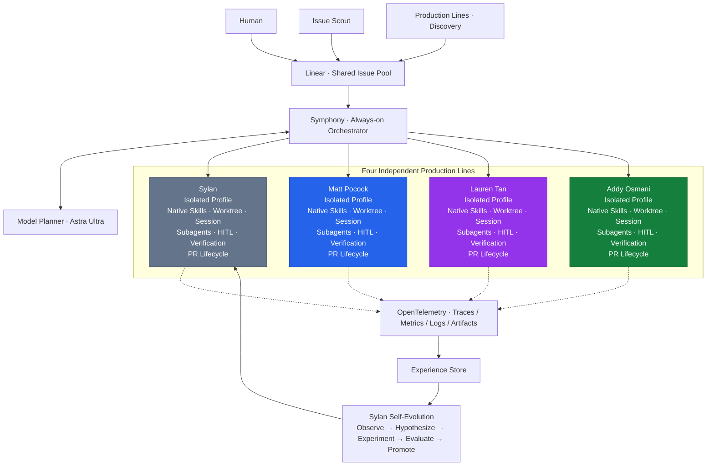

# AI Coding Workflow → AI Software Factory

## Software Factory Architecture



## 四条独立生产线

我希望通过真实开源贡献，研究不同 AI Coding 工程体系如何影响交付质量、效率与成本，并逐步演进自己的软件工厂。

| 生产线 | 工程体系 | 实践案例 |
| --- | --- | --- |
| [Sylan](workflows/sylan.md) | 自有 Engineering Workflow · Symphony | — |
| [Matt Pocock](workflows/matt.md) | 原生 skills | [Harbor #4219 · Claude Code 用量统计](cases/harbor-4219.md) |
| [Lauren Tan](workflows/pstack.md) | 原生 pstack · Skills / Playbooks / Principles | — |
| [Addy Osmani](workflows/addy.md) | 原生 Agent Skills | — |

四条生产线独立运行，共享任务池、基础设施及观测评测标准。每条生产线的主 Agent 自主选择本体系的 Skills，不预设固定 Skill Chain，也不默认混用其他体系。记录实际 Skill 调用、工程产物、验证结果、人工介入、成本与 PR 结果，事后评估路由和交付质量。

协调器使用 Python 3.11、Git 和 SQLite，Sylan 使用 Codex app-server，三条参考线使用 Claude Code 的原生插件加载器。任务领取时固定上游基线、生产线和 Skills 版本。人工作答和 PR 事件会唤醒原生产线。

[架构设计](ARCHITECTURE.md) · [20 项架构决策](DECISIONS.md) · [实施路线与验收](ROADMAP.md)

## 运行工厂

从仓库根目录运行。默认私有状态目录是 `.factory-local/`。所有读取同一任务池的进程须指向同一份 SQLite 数据库。

```powershell
python -m factory status
python -m factory doctor sylan
python -m factory doctor matt
python -m factory doctor lauren
python -m factory doctor addy
python -m unittest discover -s tests -v
```

首次使用某条参考线时，需要访问 GitHub 获取固定版本的完整作者插件。已有 profile 可通过 `python -m factory --profiles <目录> doctor <线名>` 检查。探针使用真实原生宿主和本机 OTLP 接收端，分别回读三种信号。用户可通过 `python -m factory --profiles <目录> login <线名>` 在隔离配置中完成官方登录。

Claude 的只读调查槽允许 Read、Glob、Grep、Skill 和 AskUserQuestion。需要作者 hooks、子代理或文件修改的工程回合使用本地写入槽。Windows 上的 Claude 工具规则约束常见发布命令。需要系统级出站隔离的部署还须在运行宿主配置网络策略。Linear 服务凭据由协调器进程持有。

| 操作 | 入口 |
|---|---|
| 从 Linear 入池 | `python -m factory.linear --help`。可调用已安装 Symphony 的 Tracker，或用 `python -m factory import-pool <JSON文件>` 导入连接器回读的工单。 |
| 原生选择与执行 | `python -m factory.dispatch --help`。提供规划回执、当前 Linear 范围和本地仓库基线。调度器在领取前重新核对 GitHub，原生主 Agent 自选任务。 |
| 集中处理人工决定 | `python -m factory inbox` 显示原会话、任务和问题。`python -m factory answer <决定ID> "<答复>"` 让原线在该线程的新一轮继续。 |
| 关联和跟进 PR | `python -m factory track-pr <任务UUID> <线名> <PR地址>`，随后运行 `python -m factory.github_events`。 |
| 调整资源或复议 | `python -m factory.planner --help`。每版决定带原生模型回执、修订号和摘要。 |
| 后台观察 | `python -m factory.dispatch --watch --observe-only`。心跳写在 `.factory-local/dispatcher-status.json`。Windows 可用 `scripts/start-observer.ps1`。 |

初始规划已有桌面 Astra Ultra 会话回执。无人工值守的重新规划使用显式的 `--transport responses`，只发送匿名候选计数、能力选项和预算。服务端返回实际模型、推理强度、请求 ID 与响应 ID 后才可生成新修订。这个 API 入口的账号能力仍待实测。

2026-11-27 的原生宿主发现记录为 Matt 27 项、Lauren 59 项、Addy 26 项。首次审计时，四个隔离配置均待模型登录。真实贡献验收需将一项新任务从原生会话、Skills 调用、diff 和测试关联到上游交付。[宿主与 OTLP 实测](evidence/2026-11-27/host-discovery.json) · [隔离对照](evidence/2026-11-27/profile-isolation.json) · [实施进展](ROADMAP.md)

## 文章精选

| 主题 | 文章 |
| --- | --- |
| 工作流设计 | [Lauren Tan · pstack](https://github.com/cursor/plugins/tree/005d8f6e8ec057b738adcd08a08b30db0478402d/pstack) |
| 工作流设计 | [Matt Pocock · ask-matt](https://github.com/mattpocock/skills/blob/main/skills/engineering/ask-matt/SKILL.md) |
| 软件工厂 | [LobeHub 一线复盘：实践 Super-Agent 半年后，我们对于 Agent 工程的思考](https://hub.baai.ac.cn/view/59827) |
| 全栈开发实践 | [CodeBuddy 三位一体 AI 全栈开发落地实践](https://mp.weixin.qq.com/s/v92Bl-W9hp65eb5TBfNlrA) |
| 成本与效能 | [Uber · Running a Software Factory Efficiently at Uber Scale](https://www.uber.com/us/en/blog/efficient-software-factory/) |
| 验证、审查与上线 | [美团 · 31 万行代码 AI 重构](https://tech.meituan.com/2026/05/07/Agent-AI-Coding.html) |

<details>
<summary>其余 11 篇文章</summary>

| 主题 | 文章 |
| --- | --- |
| 跨仓开发与集成 | [得物 · Harness + SDD + 多仓全栈开发](https://tech.dewu.com/article?id=221) |
| 跨仓开发与集成 | [AliExpress · Hybrid Coding](https://qcon.infoq.cn/2026/shanghai/track/1966) |
| 任务接入与交付编排 | [腾讯轻量云 · LoopForge](https://developer.cloud.tencent.com/article/2779233) |
| 任务接入与交付编排 | [腾讯游戏 · 把 Loop 接进团队](https://qcon.infoq.cn/2026/shanghai/track/1964) |
| 任务接入与交付编排 | [飞猪 · AI Native 交付大脑](https://qcon.infoq.cn/2026/shanghai/presentation/7263) |
| 项目上下文与研发资产 | [大淘宝 · AI 驱动研发体系的实践和思考](https://ai.aui2.cn/guide/frontier/posts/2026-09-02-ai-driven-rd-harness) |
| 验证、审查与上线 | [蚂蚁 · 60 万行巨石应用可验证交付](https://qcon.infoq.cn/2026/shanghai/presentation/7297) |
| 验证、审查与上线 | [飞猪 QA · 当验证追上生成](https://qcon.infoq.cn/2026/shanghai/presentation/7301) |
| 研发流程改造与效能度量 | [阿里 Qoder · 企业 AI Native 研发流程升级与重塑](https://www.infoq.cn/article/4z7Bbxy92tjAI7MB5evM) |
| 研发流程改造与效能度量 | [去哪儿 · AI 在研发组织落地的三段式路径](https://qcon.infoq.cn/2026/shanghai/presentation/7410) |
| 研发流程改造与效能度量 | [中电金信 · 从个人提效到组织提效](https://www.cnblogs.com/zhongdianjinxin/p/23451672) |

</details>
