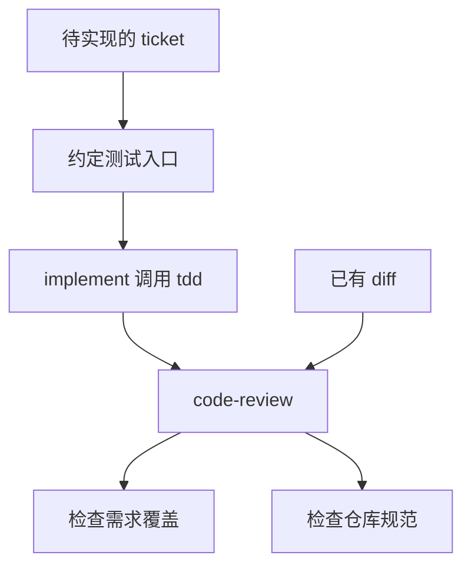

# Matt Pocock · skills

已有明确 ticket 时，从 `implement` 开始；手里已有改动时，可以从 `code-review` 接入。[作者工作流](https://github.com/mattpocock/skills/blob/main/skills/engineering/ask-matt/SKILL.md)

**我在哪里介入？** 写测试前，先约定从哪个公开接口观察结果。审查发现原先遗漏的行为时，Agent 给出证据和可选范围，我决定是否补测、是否将修复纳入本次贡献。

Harbor 是一个 Agent 评测框架。这次我们从一份已有的 diff 开始审查。两位审查者分别检查需求与规范，需求审查提出了一个可以验证的问题：如果会话日志缺少计数，但终端明确报告了数值，Harbor 会记录什么？

[阅读 Harbor #4219 的审查与回放](../cases/harbor-4219.md)
